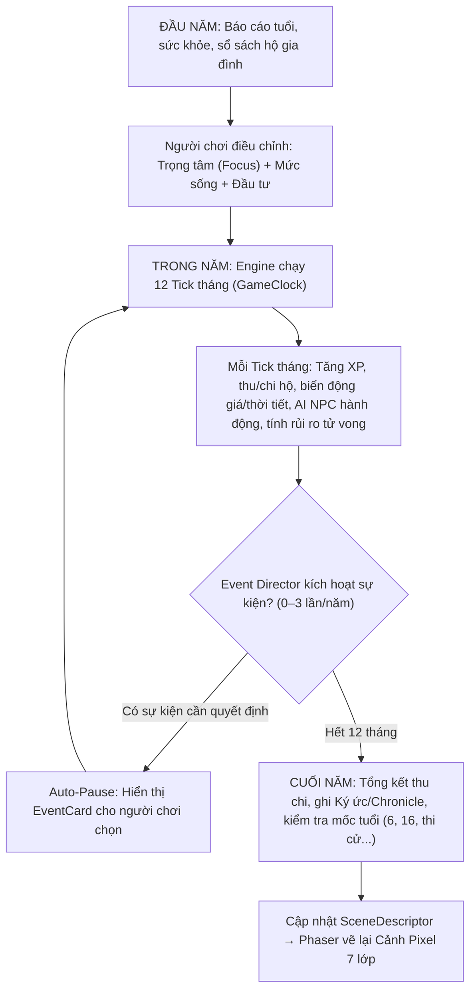

# PHÂN TÍCH TỔNG THỂ KẾ HOẠCH GDD — DÒNG ĐỜI (LEGACY OF AGES)

> **Tài liệu tổng hợp & phân tích kỹ thuật – thiết kế** từ toàn bộ 10 tài liệu GDD (`00` → `09`), tài liệu `ý tưởng.docx` và định hướng mỹ thuật (`prompt tạo art.txt`), kèm ánh xạ trực tiếp vào kiến trúc mã nguồn dự án (`src/`, `src/data/`, `public/`, `tools/`).

---

## MỤC LỤC

1. [Tổng quan, Định vị & Tầm nhìn Sản phẩm (GDD 00)](#1-tổng-quan-định-vị--tầm-nhìn-sản-phẩm-gdd-00)
2. [Gameplay & Vòng lặp 5 Tầng Thời gian (GDD 01)](#2-gameplay--vòng-lặp-5-tầng-thời-gian-gdd-01)
3. [Kiến trúc Lõi Mô phỏng — Core Machine & Ánh xạ Codebase (GDD 02)](#3-kiến-trúc-lõi-mô-phỏng--core-machine--ánh-xạ-codebase-gdd-02)
4. [Cơ chế & Hệ thống Gameplay Chuyên sâu (GDD 03)](#4-cơ-chế--hệ-thống-gameplay-chuyên-sâu-gdd-03)
5. [Hệ thống Nghề nghiệp Lắp ghép & Tổ chức (GDD 04)](#5-hệ-thống-nghề-nghiệp-lắp-ghép--tổ-chức-gdd-04)
6. [Bộ máy Sự kiện (Storylet), Event Director & Kịch bản (GDD 05)](#6-bộ-máy-sự-kiện-storylet-event-director--kịch-bản-gdd-05)
7. [Thế giới, Bản đồ 5 Lớp & Dòng thời gian Lịch sử (GDD 06)](#7-thế-giới-bản-đồ-5-lớp--dòng-thời-gian-lịch-sử-gdd-06)
8. [Khuôn Văn minh & Trọng tâm Quan liêu Nho giáo — Đại Việt (GDD 07)](#8-khuôn-văn-minh--trọng-tâm-quan-liêu-nho-giáo--đại-việt-gdd-07)
9. [Pixel Art 7 Lớp, Micro-cutscene & Giao diện Mở dần (GDD 08)](#9-pixel-art-7-lớp-micro-cutscene--giao-diện-mở-dần-gdd-08)
10. [Lộ trình Giai đoạn `[0]` → `[5]`, KPI Cân bằng & Quản trị Rủi ro (GDD 09)](#10-lộ-trình-giai-đoạn-0--5-kpi-cân-bằng--quản-trị-rủi-ro-gdd-09)
11. [Bản đồ Ánh xạ GDD sang Cấu trúc Thư mục Dự án (`src/` & `src/data/`)](#11-bản-đồ-ánh-xạ-gdd-sang-cấu-trúc-thư-mục-dự-án-src--data)

---

## 1. TỔNG QUAN, ĐỊNH VỊ & TẦM NHÌN SẢN PHẨM (GDD 00)

### 1.1. Định vị cốt lõi
- **Tên dự án**: **Dòng Đời — Legacy of Ages** (tên mã repo: `dong-doi` / `legacyOfAce`).
- **Thể loại**: Life Simulator · Dynasty Simulator · Grand Strategy · Historical Sandbox · RPG Simulation.
- **Câu định vị**: *"Không phải mọi cuộc đời đều vĩ đại. Nhưng mọi cuộc đời đều có thể để lại dấu vết trong lịch sử."*
- **Công thức lai ghép**:
  $$\text{Dòng Đời} = \text{Crusader Kings III (Chiều sâu nhân vật, gia tộc, quyền lực mềm)} + \text{BitLife / 1in8b (Nhịp nhanh theo năm, đời thường)} + \text{Bản sắc riêng}$$

### 1.2. Cách Dòng Đời giải quyết điểm yếu của CK3
| Điểm yếu của CK3 | Giải pháp đột phá của Dòng Đời |
| :--- | :--- |
| Chỉ chơi giới quý tộc/cầm quyền | **Mọi tầng lớp đều là trải nghiệm đầy đủ** (sống cả đời làm nông dân, thợ rèn, thương nhân, thảo khấu vẫn sâu sắc). |
| Dân thường chỉ là con số | Dân thường là thực thể `Character` có hộ gia đình (`Household`), ký ức, quan hệ, ước mơ. |
| Kinh tế nông (chủ yếu thu thuế) | **Kinh tế hộ gia đình** có sổ sách thu/chi/nợ, tài sản là Object thật (ruộng, trâu, cửa hàng, thuyền). |
| Giữa game nhàm chán vì snowball | **Quyền lực có chi phí tăng theo quy mô**, phe phái nội bộ, Thiên mệnh/Chính danh và nổi dậy từ dưới lên. |
| Đông Á / Đông Nam Á sơ sài | Xây dựng **Khuôn Quan liêu Nho giáo (biến thể Đại Việt)** làm khuôn Cấp A đầu tiên (khoa cử, làng xã, hương ước, cư tang, Thiên mệnh). |

### 1.3. Bốn cảm giác cốt lõi (Core Fantasy) & Bốn cơ chế đặc trưng (Signature Mechanics)
1. **Bốn cảm giác cốt lõi** (mọi tính năng không phục vụ 1 trong 4 cảm giác này đều phải cắt bỏ):
   - **Sống một đời người**: Tính cách, ký ức, quan hệ, 6 giai đoạn đời.
   - **Vươn lên**: Thang địa vị xã hội, tích lũy tài sản, cảnh Pixel Art nâng cấp trực quan.
   - **Nhân quả**: *"Không thể đoán trước, nhưng luôn hiểu được khi nhìn lại"* — Memory, Opinion, Chronicle giải thích lý do thành/bại.
   - **Di sản**: Nuôi dạy con cái, luật thừa kế, gia nghiệp, gia phả xuyên thế hệ.
2. **Bốn cơ chế đặc trưng (Signature Mechanics)**:
   - **Hệ thống Thời cơ (`opportunity`)**: Thế giới có biến trạng thái dao động (giá lúa, khí hậu chính trị, tâm trạng NPC); thông tin là tài nguyên; *"Chưa phải lúc"* là một lựa chọn chiến lược.
   - **Hạnh phúc tâm lý (`happiness`)**: 3 tầng cảm xúc, thích nghi (hedonic adaptation), kỳ vọng ($\text{Mãn nguyện} = \text{Thực tế} - \text{Kỳ vọng}$), hệ giá trị theo tính cách.
   - **Nổi dậy từ dưới lên (`rebellion`)**: Bất mãn tích tụ (Grievance), 8 giai đoạn từ kết nối bí mật, chia ô bí mật, kẻ chỉ điểm đến hậu cách mạng.
   - **Quản lý Fractal & Ủy quyền (`organization` / `economy`)**: Cùng 5 yếu tố quản lý (Nguồn lực, Con người, Rủi ro, Đầu tư, Quan hệ) lặp lại đồng dạng từ Hộ nông dân → Thương hội → Lãnh địa → Vương quốc, kèm cơ chế ủy quyền (*"Để người khác lo"*).

### 1.4. Ba tầng trải nghiệm & Ba chế độ chơi
- **3 Tầng trải nghiệm chồng lên nhau (không thay thế nhau)**:
  1. *Tầng 1 — Sống một cuộc đời* (`[0]`–`[1]`): Sinh ra, học tập, làm việc, kết hôn, mua tài sản, bệnh tật, qua đời.
  2. *Tầng 2 — Gia đình & Dòng tộc* (`[2]`): Nuôi dạy con, liên hôn, thừa kế, gia nghiệp, phục hưng dòng họ.
  3. *Tầng 3 — Quyền lực & Thế giới* (`[3]`–`[5]`): Điều hành tổ chức, lãnh địa, triều đình, quân sự, ngoại giao, cải cách thể chế.
- **3 Chế độ chơi**:
  - `One Life`: Sống trọn 1 đời (20–40 phút), kết thúc bằng Bản tổng kết đời 5 trục.
  - `Dynasty`: Tiếp nối qua nhiều thế hệ đến khi tuyệt tự hoặc dừng lại.
  - `Legacy of Ages`: Xuyên nhiều thời đại (hàng trăm – hàng nghìn năm), có cơ chế tua nhanh thập kỷ.

---

## 2. GAMEPLAY & VÒNG LẶP 5 TẦNG THỜI GIAN (GDD 01)

### 2.1. Năm tầng vòng lặp lồng nhau
| Tầng | Tên vòng lặp | Thời lượng thực | Nội dung cốt lõi |
| :--- | :--- | :--- | :--- |
| **1. Micro** | Quyết định | Vài giây | Đọc tình huống sự kiện → cân nhắc xác suất/đánh đổi → chọn phương án → nhận hậu quả. |
| **2. Meso** | Một năm | 1–3 phút | Chọn Trọng tâm (`Focus`) + Phân bổ chi tiêu/mức sống → chạy 12 tick tháng → xử lý 0–3 sự kiện → Tổng kết năm & cập nhật cảnh Pixel. |
| **3. Macro** | Một đời | 20–40 phút | Đi qua 6 giai đoạn đời → theo đuổi Tham vọng → qua đời → nhận Bản tổng kết đời. |
| **4. Meta** | Gia tộc | Vài giờ | Chuyển giao thế hệ → kế thừa tài sản/nợ/ân oán → xây dựng gia nghiệp qua nhiều đời. |
| **5. Mega** | Thời đại | Hàng chục giờ | Thế giới chuyển dịch thời đại, thể chế biến đổi, gia tộc thích nghi hoặc suy tàn. |

### 2.2. Chi tiết Meso Loop (Một năm trong game = 12 Tick tháng)

### 2.3. Sáu giai đoạn đời (`src/core/systems/life/`)
1. **Ấu thơ (`0–5 tuổi`)**: Gần như tự động, 1–2 sự kiện, câu hỏi chính: *Có sống sót qua rủi ro tử vong trẻ em không?*
2. **Thiếu thời (`6–15 tuổi`)**: Cha mẹ định hướng giáo dục (trường làng, học nghề, chăn trâu), hình thành tính cách từ môi trường.
3. **Thanh niên (`16–25 tuổi`)**: Chọn nghề, học nghề, thi cử lần đầu, tình yêu đầu, lập hộ riêng (cho phép người chơi cũ chọn bắt đầu ngay từ tuổi 16).
4. **Lập nghiệp (`26–40 tuổi`)**: Kinh doanh, tích lũy tài sản, kết hôn, sinh con, thăng bậc nghề.
5. **Trung niên (`41–55 tuổi`)**: Củng cố vị thế, đỉnh cao sự nghiệp, đối mặt khủng hoảng con cái trưởng thành hoặc phe phái.
6. **Tuổi già (`56+ tuổi`)**: Sức khỏe suy giảm, viết di chúc, chọn người kế vị, hòa giải ân oán, đối diện cô đơn tuổi già.

### 2.4. Hệ thống Trọng tâm (`Focus` — `src/data/focuses/`)
Người chơi không điều khiển vi mô từng ngày mà lái cuộc đời qua **Focus** (1 Focus chính + 1 Focus phụ khi trưởng thành). Mỗi Focus tác động lên 3 trục:
1. **Tăng XP kỹ năng** tương ứng (`Học tập`, `Rèn luyện`, `Sức khỏe`, `Gia đình`, `Giao lưu`, `Kinh doanh`, `Chính trị`, `Quân sự`, `Quản trị`, `Nghỉ ngơi`).
2. **Bộ lọc sự kiện**: Thay đổi trọng số kho sự kiện mà `Event Director` bốc ra.
3. **Mức phơi nhiễm (Exposure)**: Ví dụ chọn Focus `Chính trị` giúp tăng cơ hội gặp quý nhân bảo trợ nhưng đồng thời tăng rủi ro bị cuốn vào đấu đá phe phái.

### 2.5. Mô hình Hạnh phúc tâm lý & Cái chết
- **Ba tầng cảm xúc (`src/core/systems/happiness/`)**:
  1. *Cảm xúc tức thời* (ngắn hạn do sự kiện vừa xảy ra).
  2. *Tâm trạng (Mood)* (trung hạn theo tháng/năm, chịu ảnh hưởng bởi Stress, sức khỏe, mức sống).
  3. *Mãn nguyện đời (Life Satisfaction)*: $\text{Mãn nguyện} = \text{Thực tế đạt được} - \text{Kỳ vọng xã hội/gia đình}$, có cơ chế **Thích nghi (Hedonic Adaptation)** sau ~3 năm và đối chiếu với **Hệ giá trị theo tính cách**.
- **Bản tổng kết đời 5 trục độc lập** (không cộng gộp thành 1 điểm duy nhất): `Mãn nguyện`, `Di sản`, `Dấu ấn`, `Gia đình`, `Tham vọng`.
- **Mô hình rủi ro tử vong theo tháng (`src/core/systems/life/`)**:
  $$\text{Rủi ro tử vong tháng} = f(\text{Tuổi}, \text{Bệnh}, \text{Nghề}, \text{Chiến tranh}, \text{Dịch bệnh}, \text{Kẻ thù}, \text{Tai nạn}, \text{Mức sống}, \text{Mùa}, \text{Sinh nở})$$
  Mọi cái chết đều được ghi rõ nguyên nhân nhân quả vào Biên niên sử (`Chronicle`).

---

## 3. KIẾN TRÚC LÕI MÔ PHỎNG — CORE MACHINE & ÁNH XẠ CODEBASE (GDD 02)

### 3.1. Mô hình thực thể cốt lõi (`src/core/entities/`)
- **`Household.ts` là đơn vị kinh tế trung tâm, KHÔNG phải `Character.ts`**: Tiền bạc, nợ nần, nhà cửa, ruộng đất thuộc về `Household`. Thiết kế này giải quyết triệt để và tự nhiên bài toán thừa kế, góa bụa, phân chia gia sản và tách hộ.
- **`Character.ts`** lưu 9 nhóm thuộc tính: Định danh (tên tục, tên chữ, thụy hiệu, quê quán, nơi ở), Trạng thái (sức khỏe, danh sách bệnh, stress, 3 tầng cảm xúc), Năng lực (7 kỹ năng + XP + perks), Bản ngã (tính cách, giá trị sống, tham vọng), Xã hội (thân phận, nghề, bậc, lối sống, dự nghiệp, danh tiếng theo nhóm), Quan hệ (`Opinion` + `Hook` + `Ân tình`), Tri thức (bí mật/tin đồn đã biết), Ký ức (`Memory` có điểm quan trọng & thời hạn), và Mô phỏng (`LOD Tier T0–T3`, `personalSeed`).

### 3.2. Năm Module Engine Nền tảng (`src/core/engine/`)
1. **[`Rng.ts`](file:///home/thanhhai/myProjects/GamesProject/legacyOfAce/src/core/engine/Rng.ts) (Hierarchical Seeded RNG)**:
   - Phân cấp hạt giống: `WorldSeed` → `RegionSeed` → `SettlementSeed` → `HouseholdSeed` → `CharacterSeed`.
   - Đảm bảo tính **tất định (Deterministic) 100%**: cùng seed + cùng lựa chọn = cùng kết quả, phục vụ kiểm thử headless và sinh lười (Lazy Generation) nhất quán.
2. **[`GameClock.ts`](file:///home/thanhhai/myProjects/GamesProject/legacyOfAce/src/core/engine/GameClock.ts) (Hệ thống thời gian)**:
   - Điều phối `tickMonth()` (12 lần/năm cho T0–T1, kinh tế, sức khỏe, sự kiện) và `tickYear()` (cho AI T2, thống kê T3, kiểm tra mốc đời, tổng kết năm).
   - Hỗ trợ hiển thị song song Lịch văn hóa bản địa (Niên hiệu, Can Chi) và Năm Công nguyên.
3. **[`ModifierSystem.ts`](file:///home/thanhhai/myProjects/GamesProject/legacyOfAce/src/core/engine/ModifierSystem.ts) (Hệ thống cộng/trừ có truy vết nguồn)**:
   - Mọi tác động lên chỉ số đều lưu cấu trúc: `{ sourceId, sourceLabel, targetStat, value, operation: 'add' | 'mul', durationMonths, decayRate }`.
   - Giúp UI hiển thị Tooltip giải thích minh bạch tại sao chỉ số tăng/giảm.
4. **[`RuleEvaluator.ts`](file:///home/thanhhai/myProjects/GamesProject/legacyOfAce/src/core/engine/RuleEvaluator.ts) (Bộ đánh giá điều kiện DSL)**:
   - Đánh giá cấu trúc điều kiện tổ hợp (`all`, `any`, `not`, so sánh biến trạng thái `household`, `character`, `world`, `organization`) dùng chung cho Sự kiện, Cổng nghề, Luật thừa kế và Utility AI.
5. **[`SaveSystem.ts`](file:///home/thanhhai/myProjects/GamesProject/legacyOfAce/src/core/engine/SaveSystem.ts) (Lưu trữ Delta trên IndexedDB)**:
   - Chỉ lưu phần dữ liệu thay đổi (Delta) so với trạng thái sinh ra từ Seed gốc; tự động nén các sự kiện điểm thấp trong quá khứ thành bản tóm tắt thập kỷ để giữ dung lượng file lưu nhẹ trên Web/Mobile.

### 3.3. Mô phỏng NPC 4 tầng LOD (`src/core/world/` & `src/core/systems/ai/`)
| Tầng LOD | Đối tượng áp dụng | Tần suất cập nhật | Số lượng mục tiêu | Cơ chế xử lý |
| :--- | :--- | :--- | :--- | :--- |
| **T0** | Hộ gia đình của người chơi | Mỗi tháng (`tickMonth`) | 5 – 15 | Mô phỏng đầy đủ mọi chỉ số, bệnh tật, thu chi. |
| **T1** | Họ hàng gần, kẻ thù, cấp trên, nhân vật quyền lực trong vùng | Mỗi tháng (`tickMonth`) | 100 – 300 | Chạy **Utility AI** (chấm điểm hành động theo `Mục tiêu × Tính cách × Nguồn lực`). |
| **T2** | Dân cư cùng làng/thị trấn/tỉnh | Mỗi năm (`tickYear`) | 1.000 – 5.000 | Hồ sơ rút gọn (tuổi, nghề, hộ); tự động thăng lên **T1** khi kết giao với người chơi. |
| **T3** | Dân số các tỉnh xa | Mỗi năm (`tickYear`) | Không giới hạn | Chỉ lưu con số thống kê (tổng dân số, thịnh vượng, mức bất mãn). |

---

## 4. CƠ CHẾ & HỆ THỐNG GAMEPLAY CHUYÊN SÂU (GDD 03)

### 4.1. Công thức kết quả 4 yếu tố
$$\text{Kết Quả} = \underbrace{\text{Quyết định} \times \text{Thời điểm} \times \text{Hoàn cảnh}}_{\approx 70\%\text{ (Người chơi kiểm soát & chuẩn bị)}} \times \underbrace{\text{Vận may}}_{\approx 30\%\text{ (RNG theo chế độ Số phận)}}$$

### 4.2. Hệ thống Chỉ số, 7 Kỹ năng & 8 Cặp Tính cách
- **3 loại chỉ số**:
  - *Gauge (0–100)*: `Sức khỏe` (kèm danh sách bệnh có tiến triển & thương tật vĩnh viễn), `Stress / Tinh thần` (đầy cây sẽ kích hoạt trạng thái "Phá vỡ / Mental Break").
  - *Derived (Tính toán động)*: `Danh tiếng` (tách riêng theo nhóm: Dân làng, Thương hội, Quý tộc, Sĩ phu, Giang hồ), `Ảnh hưởng`, `An toàn`.
  - *Ledger (Sổ sách)*: Bảng cân đối thu/chi/nợ/lương thực/tài sản của `Household`.
- **7 Kỹ năng (`src/data/skills/`)**: `Quân sự`, `Ngoại giao`, `Quản trị`, `Mưu lược`, `Thương mại`, `Học vấn`, `Sinh tồn / Nghề`.
  - *Cơ chế đặc biệt*: Kỹ năng đóng vai trò là **"Kính lúp thông tin"** — kỹ năng càng cao thì khoảng dự báo xác suất trên `EventCard` càng hẹp và tin đồn nhận được càng chính xác.
- **8 Cặp Tính cách đối lập (`src/data/traits/`)**:
  `Tham vọng / An phận`, `Nhân từ / Tàn nhẫn`, `Kiên nhẫn / Nóng nảy`, `Trung thành / Cơ hội`, `Hào phóng / Tham lam`, `Can đảm / Thận trọng`, `Coi trọng gia đình / Tự do`, `Mộ đạo / Hoài nghi`.

### 4.3. Kinh tế Hộ, Tài sản Object & 5 Bậc Mức sống (`src/core/systems/economy/`)
- Mỗi tài sản (`Property.ts`: ruộng, trâu, nhà, cửa hàng, thuyền) là một Object có: `Giá trị thị trường`, `Thu nhập/năm`, `Chi phí bảo trì/thuế`, `Rủi ro hư hại`, `Thanh khoản`, `Yêu cầu kỹ năng/địa vị`, và `Pixel Layer ID`.
- **5 bậc Mức sống** (`Khổ cực` · `Đạm bạc` · `Đủ đầy` · `Sung túc` · `Xa hoa`): Một quyết định đầu năm chạm cùng lúc 5 hệ thống (Ngân sách hộ, Sức khỏe, Tinh thần, Danh tiếng tầng lớp, Triển vọng hôn nhân của con và Cảnh Pixel).

### 4.4. Quan hệ Xã hội & Quyền lực mềm (`src/core/systems/social/`)
- `Opinion` là tổng các `Modifier` có thời hạn suy giảm theo năm.
- **5 công cụ Quyền lực mềm** hoạt động ở mọi tầng lớp (kể cả nông dân):
  1. `Ân tình (Favor)`: Cứu giúp/cho vay lúc ngặt nghèo → đòi lại khi cần.
  2. `Nắm thóp (Hook)`: Nắm bí mật hoặc nợ lớn để ép đối phương tuân phục.
  3. `Bí mật (Secret)`: Tội lỗi cũ, thân thế ẩn, tham ô, ngoại tình, hội kín.
  4. `Mưu sự (Scheme)`: Kế hoạch kéo dài nhiều tháng/năm có thanh tiến độ và rủi ro bại lộ.
  5. `Uy hiếp (Dread)`: Khuất phục người khác bằng nỗi sợ.

### 4.5. Hệ thống Nổi dậy từ dưới lên 8 Giai đoạn (`src/core/systems/rebellion/`)
1. `Căm phẫn (Grievance)` → 2. `Kết nối` → 3. `Tổ chức (chia ô bí mật, tích lương/vũ khí)` → 4. `Chờ thời (đợi lãnh chúa xuất chinh/mất mùa)` → 5. `Khởi nghĩa` → 6. `Lan rộng` → 7. `Kết cục` → 8. `Hậu nổi dậy (giữ lời hứa chia ruộng hay biến thành bạo chúa mới)`.

---

## 5. HỆ THỐNG NGHỀ NGHIỆP LẮP GHÉP & TỔ CHỨC (GDD 04)

### 5.1. Tổ hợp 4 lớp tạo thành Con đường (Path)
$$\text{Con đường} = \text{Thân phận (Status)} + \text{Vai trò/Nghề (Role)} + \text{Lối sống (Passion)} + \text{Dự nghiệp (Venture)}$$
- Mỗi Vai trò có **Bổn phận (Duties)** bắt buộc và người chơi có **Quỹ tâm sức (100%)** hữu hạn. Nếu dồn tâm sức cho Lối sống cá nhân mà bỏ bê Bổn phận, cấp dưới/tể tướng được ủy quyền sẽ nắm quyền (có thể giúp đất nước thịnh trị nếu trung thành, hoặc lũng đoạn nếu tham lam).

### 5.2. Kiến trúc Lego 3 tầng & Hợp đồng nghề (`src/data/careers/`)
- Thay vì kế thừa cứng (OOP Inheritance), nghề nghiệp được lắp ghép từ các **Career Components** (`src/core/systems/career/`): `Thang bậc`, `Tổ chức`, `Lãnh thổ`, `Đội quân`, `Hạm đội`, `Tuyến buôn`, `Kho hàng`, `Xưởng`, `Truy nã`, `Hậu cung`, `Học trò`, `Khách hàng`, `Bổn phận`, `Dự nghiệp`, `Hang ổ`.
- **4 Nghề trọng tâm của Giai đoạn 1** (kiểm chứng toàn bộ các khối Lego cốt lõi):
  1. **Nông dân**: `Ruộng đất` + `Hộ gia đình` + `Làng (Tổ chức)` + `Bổn phận (thuế, sưu dịch)`.
  2. **Thương nhân**: `Kho hàng` + `Tuyến buôn` + `Thương hội (Tổ chức)` + `Khách hàng`.
  3. **Lính → Tướng**: `Thang bậc quân đội` + `Đơn vị/Đội quân (Tổ chức)` + `Bổn phận chiến trận`.
  4. **Thảo khấu**: `Băng đảng (Tổ chức)` + `Truy nã` + `Hang ổ` + `Lãnh thổ ngầm`.

---

## 6. BỘ MÁY SỰ KIỆN (STORYLET & SỰ KIỆN THƯỜNG), EVENT DIRECTOR & KỊCH BẢN (GDD 05)

### 6.1. Hai loại sự kiện bổ trợ nhau: Sự kiện quyết định vs. Sự kiện thường (Dòng đời)
| Tiêu chí | Sự kiện quyết định (`Decision Storylet`) | Sự kiện thường / Dòng đời (`Ambient Life Log`) |
| :--- | :--- | :--- |
| **Thao tác người chơi** | Phải đọc và chọn phương án (2–5 lựa chọn) | Chỉ đọc trong Nhật ký theo năm (giống *1in8b*) |
| **Nhịp thời gian** | Dừng thời gian (`Auto-pause`) | Thời gian vẫn chạy bình thường |
| **Số lượng / năm** | `0 – 3` sự kiện / năm | `3 – 8` dòng / năm (tùy giai đoạn đời) |
| **Tác động số học** | Lớn, tạo ngã rẽ cuộc đời | Nhỏ (`±1–3`) hoặc chỉ tạo màu sắc |
| **Vai trò thiết kế** | Tạo bước ngoặt nhân quả | Tạo cảm giác "đang sống", phần "thịt" giữa các ngã rẽ, gieo mầm cho tương lai |

### 6.2. Cấu trúc chuẩn của một Sự kiện quyết định (`Storylet` — `src/data/events/`)
Mỗi sự kiện quyết định khai báo trong YAML/JSON được kiểm tra qua Zod Schema gồm:
- `id`, `tags` (kho sự kiện, nghề, bậc, lối sống, khuôn văn minh, giai đoạn đời).
- `condition`: Biểu thức `RuleEvaluator`.
- `roles`: Danh sách vai trò rút từ NPC thực trong mô phỏng (ví dụ `[creditor]`, `[child]`).
- `weight` & `weightModifiers`: Trọng số cơ bản và hệ số nhân theo tính cách/hoàn cảnh.
- `cooldownYears` / `oncePerLife`: Chống lặp sự kiện.
- `options` (2–5 lựa chọn): Bao gồm đánh đổi thật, khoảng xác suất thành công (hiển thị mờ/rõ tùy kỹ năng), phương án *"Chưa phải lúc"* (hoãn có trả giá), và hậu quả Ngắn / Trung / Dài hạn (sinh `Memory`, `Flag` kích hoạt chuỗi sự kiện xuyên thế hệ).
- `localizationTokens`: Chuỗi văn bản dùng biến động theo văn hóa (`{cây_trồng_chính}`, `{chức_danh_thu_thuế}`).

### 6.3. Thiết kế chi tiết Sự kiện thường — Nhật ký dòng đời (`Ambient Life Log`)
1. **5 Nguồn sinh dòng nhật ký**:
   - *(a) Báo cáo từ mô phỏng*: Tuổi mới, sản lượng vụ mùa, kỹ năng vừa tăng, bệnh vừa khỏi.
   - *(b) Chuyện người quanh mình*: Chị lấy chồng làng bên, ông lý trưởng qua đời, bạn hàng xóm rủ đi bắt cá (lấy từ NPC thật).
   - *(c) Tin thế giới vọng tới*: Lọc theo khoảng cách và tầng lớp (nông dân nghe tin đồn có thể sai; quan lại nghe tin triều đình chính xác).
   - *(d) Chuyện vặt đời thường*: Bị chó nhà bá hộ đuổi, nhặt được đồng tiền ở chợ, nằm mơ thấy điềm lành.
   - *(e) Điềm báo & tin đồn*: Trời hạn sớm giá lúa nhích lên, người lạ xuất hiện quanh làng (gieo mầm cho Hệ thống Thời cơ).
2. **4 Mức hiển thị trên `LifeHud`**:
   - *Dòng thường*: 1 dòng trong nhật ký năm.
   - *Dòng nổi bật*: Chữ đậm, icon lớn (mốc đời: đi học, cưới, sinh con, tang sự), có thể kèm micro-cutscene.
   - *Bong bóng trên cảnh Pixel*: Nhân vật trên `LifeScene` hiện biểu cảm hoặc bong bóng thoại ngắn (`"Á!"`).
   - *Thẻ quyết định*: Dừng game, bật `EventCard`.
3. **12 Quy tắc vận hành bắt buộc (`R1` → `R12`)**:
   - **R1 (Không bịa)**: Mọi dòng phải khớp dữ liệu mô phỏng thật (có nhà bá hộ thật trong làng mới bị chó nhà bá hộ đuổi).
   - **R2 (Liên quan trực tiếp)**: Chỉ hiện chuyện người gần mình; chuyện người xa chỉ hiện khi thật lớn.
   - **R3 (Định mức theo tuổi)**: Ấu thơ `1–3 dòng`, Thiếu thời `3–5 dòng`, Trưởng thành `3–6 dòng`, Tuổi già `2–5 dòng`, Đang tua nhanh gộp còn `1–2 dòng`.
   - **R4 (Ưu tiên & Gộp theo `diem_quan_trong`)**: Năm nhiều biến cố thì giữ dòng điểm cao, tự động gộp các dòng điểm thấp thành 1 câu tổng hợp.
   - **R5 (Chống lặp)**: Có cooldown (`cho_lai`) và `3–5` cách viết (`cach_viet`) cho mỗi mẫu; engine ghi nhớ biến thể vừa dùng.
   - **R6 (Cân bằng cảm xúc)**: Năm vừa có tang sự thì `Event Director` chặn chuyện vặt vui nhộn, ưu tiên dòng an ủi.
   - **R7 (Năm trống vẫn có chữ)**: Tự sinh câu tổng kết mùa vụ và tâm trạng nếu năm đó bình lặng.
   - **R8 (Đúng thời đại, văn hóa, tầng lớp)**, **R9 (Tác động nhỏ `±1–3`)**, **R10 (Gieo mầm / Seeding tính cách nhẹ hoặc quan hệ bạn thuở nhỏ, chuỗi mini-arc như nuôi mèo từ 6 đến 16 tuổi)**, **R11 (Ngôi kể "Bạn" thống nhất, tên gọi đổi theo đời)**, **R12 (Nhãn `(tin đồn)` rõ ràng, độ chính xác phụ thuộc kỹ năng `Mưu lược`)**.
4. **Công thức nhân tổ hợp & Khối lượng mục tiêu**:
   $$\text{Độ đa dạng} = \text{Mẫu sự kiện} \times \text{NPC thật} \times \text{Địa điểm} \times \text{Mùa} \times \text{Phản ứng tính cách} \times \text{Cách viết}$$
   - **Giai đoạn 0 (`[0]`)**: `40 – 60 mẫu` sự kiện thường (`2–3` cách viết/mẫu) + `~15` sự kiện quyết định.
   - **Giai đoạn 1 (`[1]`)**: `150 – 250 mẫu` sự kiện thường (`3–5` cách viết/mẫu) + `30 – 50` mẫu sự kiện quyết định.

### 6.4. Event Director (Đạo diễn nhịp độ)
- Theo dõi **Thang căng thẳng (Tension Meter)** của người chơi: điều tiết cả **Sự kiện quyết định** lẫn tông cảm xúc của **Sự kiện thường**.
- Giới hạn tối đa **0–3 sự kiện cần quyết định/năm** và duy trì **2–3 việc dang dở (Open Loops)** cùng lúc để tạo lực hút *"chơi thêm 1 năm nữa"*.
- Tuyệt đối không gian lận kết quả xúc xắc đã hiển thị, nhưng có **Bad-luck protection** (chặn việc chết bất ngờ liên tiếp nhiều người thân trong 1 năm trừ khi có đại dịch/chiến tranh).

---

## 7. THẾ GIỚI, BẢN ĐỒ 5 LỚP & DÒNG THỜI GIAN LỊCH SỬ (GDD 06)

### 7.1. Kiến trúc Bản đồ 5 Lớp cấp Tỉnh (`src/data/world/`)
1. **Lớp Địa lý (Cố định)**: Địa hình, sông ngòi, khí hậu, tài nguyên.
2. **Lớp Tỉnh / Vùng (Cố định)**: Lưới ~2.000 tỉnh toàn cầu; không đi sâu vẽ bản đồ dưới cấp tỉnh (làng/xóm sinh tự động theo quy tắc ngôn ngữ văn hóa).
3. **Lớp Định cư (Theo thời gian)**: Kinh thành, cảng, thị trấn, làng nông (`settlement_types.yaml`).
4. **Lớp Văn hóa / Tôn giáo / Khuôn văn minh (Biến đổi chậm)**.
5. **Lớp Chính trị (Biến đổi nhanh)**: Lưu dưới dạng bảng khoảng thời gian (`fromYear` – `toYear` tỉnh thuộc `Polity` nào) kèm lịch sử đổi tên địa danh (ví dụ: *Đại La → Thăng Long → Đông Đô → Đông Quan → Đông Kinh → Hà Nội*).

### 7.2. Bộ xương lịch sử thật + Phần thịt sinh tự động (Lazy Generation)
- **Bộ xương thật**: Các triều đại, vua chúa lớn, kinh đô, đại dịch/thiên tai khí hậu lớn (từ `Wikidata CC0`, `OpenHistoricalMap CC0`, `NOAA Paleoclimatology`, biên niên sử cổ).
- **Phần thịt sinh tự động**: Quan huyện, lý trưởng, địa chủ, hộ nông dân được sinh lười (`Lazy Generation`) từ Seed của khu định cư theo đúng tỷ lệ dân số (`HYDE`) và cấu trúc dòng họ làng xã khi người chơi tương tác.

---

## 8. KHUÔN VĂN MINH & TRỌNG TÂM QUAN LIÊU NHO GIÁO — ĐẠI VIỆT (GDD 07)

### 8.1. Kiến trúc 3 tầng Văn minh (`src/data/civilizations/` & `src/data/cultures/`)
$$\text{Khuôn Văn Minh (13 khuôn)} \longrightarrow \text{Văn Hóa (Hán, Việt, Triều Tiên...)} \longrightarrow \text{Quốc Gia / Thời Kỳ (Đại Việt thời Trần, Lê sơ...)}$$

### 8.2. Đặc tả Khuôn Cấp A đầu tiên: QUAN LIÊU NHO GIÁO (`nho_giao.yaml`)
- **5 Tài nguyên đặc thù**:
  1. `Thiên mệnh` (của Triều đại — mất mùa, lũ lụt, sao chổi làm giảm Thiên mệnh → tăng mạnh xác suất khởi nghĩa).
  2. `Phẩm hàm` (Cửu phẩm → Nhất phẩm; quan bổ nhiệm và luân chuyển, không cha truyền con nối đất phong như Phong kiến châu Âu).
  3. `Danh vọng sĩ phu` (uy tín trong giới trí thức).
  4. `Hiếu đạo` (tự ý kết hôn trái lời cha mẹ hoặc bỏ cư tang bị phạt nặng).
  5. `Vị thứ trong làng` (chỗ ngồi ở đình làng, tiếng nói trong hương ước — *"Phép vua thua lệ làng"*).
- **Thang địa vị Tứ dân (`Sĩ – Nông – Công – Thương`)**: Tạo mâu thuẫn kinh điển **"Giàu mà không sang"** (thương nhân giàu nứt đố đổ vách vẫn ngồi chiếu dưới ở đình làng, phải đầu tư cho con đi học thi đỗ Khoa cử để đổi vận gia tộc).
- **Con đường Khoa cử & Quan trường**: Học thầy đồ → Thi Hương → Thi Hội → Thi Đình → Cutscene **Vinh quy bái tổ** → Bổ nhiệm quan chức → Khảo xét định kỳ / Chọn phe / Can gián vua / Về quê **Cư tang 3 năm** khi cha mẹ mất (dễ mất ghế ở triều đình).

---

## 9. PIXEL ART 7 LỚP, MICRO-CUTSCENE & GIAO DIỆN MỞ DẦN (GDD 08)

### 9.1. Ghép cảnh Pixel Art 7 lớp từ `SceneDescriptor` (`src/game/scene-layers/`)
Phaser không chứa logic game mà chỉ đọc `SceneDescriptor` từ `@core` để lắp ghép 7 lớp:
1. **Lớp 1 — Địa hình (`terrain`)**: Đồng lúa, rừng, ven sông, phố thị theo vùng.
2. **Lớp 2 — Công trình (`buildings`)**: Nhà tranh vách đất → Nhà gỗ 3 gian → Nhà ngói nhiều gian/nhà thờ họ → Phủ đệ → Hoàng thành.
3. **Lớp 3 — Thời tiết, Mùa & Ánh sáng (`effects`)**: Xuân/Hạ/Thu/Đông, mưa, nắng, sương mù, ánh lửa vàng cam tương phản bóng tối xanh tím đậm (theo chuẩn Cinematic Pixel Art 16:9).
4. **Lớp 4 — Nhân vật & Trang phục (`characters`)**: Thành viên hộ gia đình với trang phục đúng tầng lớp.
5. **Lớp 5 — Đồ vật & Tài sản (`props`)**: Trâu, đống rơm, kho lúa, xe hàng, thuyền.
6. **Lớp 6 — Tình trạng (`condition`)**: Bình yên, sung túc, ngập lụt, hạn hán, nhà cháy, chiến loạn.
7. **Lớp 7 — Hiệu ứng hạt (`particles/ambient`)**: Khói bếp, lá rụng, mưa rơi, đom đóm.

### 9.2. Giao diện Mở dần — Progressive Disclosure (`src/ui/`)
- Màn hình chính (`LifeHud`) giữ sự tối giản như *1in8b/BitLife*: Cảnh Pixel ở trên, Hồ sơ + Trọng tâm + Việc dang dở ở giữa, Thanh hành động và Thẻ sự kiện (`EventCard`) ở dưới.
- Các bảng nâng cao (`Properties`, `Career`, `Family`, `Succession`, `Organization`, `Map`) chỉ mở khóa khi nhân vật đạt đến độ tuổi, nghề nghiệp hoặc địa vị tương ứng.
- Số liệu hiển thị theo **mô hình lai**: Mặc định hiển thị bằng ngôn từ tự nhiên (*"Sức khỏe: Khá, đang ho"*, *"Khả năng thành công: Khá cao 60–75%"*), kèm nút/tooltip mở rộng xem chi tiết từng `Modifier` nguồn.

---

## 10. LỘ TRÌNH GIAI ĐOẠN `[0]` → `[5]`, KPI CÂN BẰNG & QUẢN TRỊ RỦI RO (GDD 09)

### 10.1. Lộ trình 6 Giai đoạn phát triển (Milestones `[0]` → `[5]`)
| Giai đoạn | Tên Milestone | Phạm vi cốt lõi | Câu hỏi kiểm chứng bắt buộc |
| :---: | :--- | :--- | :--- |
| **`[0]`** | **Prototype Vòng lặp** | 1 xuất thân (Nông dân), 1 cảnh ghép lớp, ~15 sự kiện, tick tháng/năm, Focus, Mức sống, Sổ sách hộ. | *Vòng lặp 1 năm (Meso loop) có vui và tạo cảm giác nhân quả không?* |
| **`[1]`** | **Core Life Simulator** | Khuôn Nho giáo (cảm hứng Đại Việt), 3 xuất thân (Nông dân, Thương nhân, Quý tộc nhỏ), 4 nghề sâu (Nông dân, Thương nhân, Lính→Tướng, Thảo khấu), Thời cơ, Hạnh phúc tâm lý, 30–50 mẫu sự kiện, Tổng kết đời. | *Sống trọn 1 đời người (20–40 phút) có hấp dẫn chỉ với quyết định và hậu quả không?* |
| **`[2]`** | **Dynasty Simulator** | Con cái, giáo dục, hôn nhân, luật thừa kế, gia phả, ký ức xuyên đời, gia nghiệp, 5–8 dòng họ trong vùng, AI NPC T1, thang địa vị. | *Khi nhân vật đầu tiên qua đời, người chơi có hào hứng chơi tiếp đời con cháu không?* |
| **`[3]`** | **Kingdom Simulator** | Bản đồ cấp tỉnh, Tổ chức đầy đủ, Chính trị, Quân sự, Ngoại giao, Nổi dậy 8 giai đoạn, Dự nghiệp, Hậu cung, thêm nghề Sĩ tử/Quan văn, Nam tước, Vua, Cướp biển. | *Người chơi có thể đi từ dân thường lên nắm quyền — hoặc lật đổ kẻ cầm quyền không?* |
| **`[4]`** | **Living World** | Đa vùng, Polity AI, LOD T0–T3 đầy đủ, Thiên tai/Dịch bệnh lớn, 2 Khuôn Cấp A (Quan liêu Nho giáo + Phong kiến Kitô giáo), Historical World khu vực Đông Á. | *Thế giới tự vận hành có đủ sống động và đáng khám phá ngay cả khi không làm vua?* |
| **`[5]`** | **Legacy of Ages** | Hệ thống Thời đại (Era System: Nguyên thủy → Hiện đại), 11 Mốc lịch sử (Bookmarks), chuyển đổi thể chế & công nghệ xuyên thế kỷ. | *Chiến dịch kéo dài nhiều thế kỷ có giữ được sự bất ngờ và hứng thú không?* |

### 10.2. Bộ 11 Chỉ số KPI Cân bằng (Đo tự động bằng `tools/simulate/`)
Headless Simulator chạy tự động 1.000+ cuộc đời với 5 loại Bot (`An phận`, `Liều lĩnh`, `Tham vọng`, `Ngẫu nhiên`, `Tối ưu`) để kiểm tra các ngưỡng KPI:
1. **Tuổi thọ trung bình**: `50 – 65 tuổi`.
2. **Tỷ lệ tử vong trẻ em (`0–5 tuổi`)**: `15% – 25%` (thấp hơn lịch sử thật để tránh gây ức chế).
3. **Thời lượng thực 1 đời**: `20 – 40 phút`.
4. **Số quyết định sự kiện trung bình mỗi năm**: `1 – 2 quyết định/năm`.
5. **Tỷ lệ cơ động xã hội (Nông dân → Quý tộc thấp/Quan lại sau 3–4 đời)**: `30% – 50%` với bot chơi có chiến lược.
6. **Tỷ lệ tuyệt tự dòng họ sau 100 năm**: `< 10%` với người chơi cẩn thận.
7. **Tỷ lệ chết hoàn toàn bất ngờ (không dấu hiệu báo trước)**: `< 5%` ở chế độ mặc định (*Đời thực*).
8. **Độ phân tán kết cục & nghề nghiệp**: Không có chiến lược hay nghề nào thắng áp đảo trong mọi thời thế.
9. **Tỷ lệ lặp sự kiện trong cùng 1 đời**: Gần bằng `0%`.
10. **Số việc dang dở (Open Loops) duy trì cùng lúc**: Luôn giữ `2 – 3 việc`.

### 10.3. Bảng 12 Quyết định Thiết kế & Kỹ thuật Đã Chốt
| # | Hạng mục | Quyết định chính thức |
| :---: | :--- | :--- |
| **1** | **Nhịp chơi & Thời gian** | **Game chạy thời gian tự trôi (Real-time tick) và có Pause / Auto-pause** (chỉnh tốc độ `1×, 2×, 4×, 8×, 12×`; tự dừng khi có Sự kiện quyết định; Sự kiện thường tự chảy vào Nhật ký năm). |
| **2** | **Đơn vị điều khiển** | **Ý chí gia tộc, hiện thân qua một nhân vật** tại một thời điểm. |
| **3** | **Minh bạch số liệu** | **Lai**: Mặc định hiển thị bằng lời, có tùy chọn xem chi tiết con số và `Modifier` nguồn. |
| **4** | **Mức hiện thực** | **Mặc định “Đời thực”**, có chế độ chọn (`Đời bình lặng` · `Đời thực` · `Số phận khắc nghiệt` · `Tùy chỉnh`). |
| **5** | **Phạm vi bản đồ GĐ1** | **Một làng + một thị trấn + một lâu đài/phủ**. |
| **6** | **Nền tảng chính** | **Web / PC**. |
| **7** | **Thế giới khởi đầu** | **Lai**: Thế giới giả tưởng lấy cảm hứng rõ từ một vùng lịch sử trước khi mở Historical World. |
| **8** | **Khuôn văn minh Cấp A đầu tiên** | **Quan liêu Nho giáo (biến thể Đại Việt)**. |
| **9** | **Điều khiển người thừa kế** | **Điều khiển đầy đủ**; làm trái tính cách của người thừa kế sẽ gây tăng **Stress**. |
| **10** | **Mô hình kinh doanh** | **Chưa cần quan trọng** ở giai đoạn hiện tại. |
| **11** | **Bộ công nghệ (Tech Stack)** | **TypeScript + Pure Sim Core (`@core`) + Phaser (`@game`) + React (`@ui`) + Vite + YAML/JSON + Zod + IndexedDB**. |
| **12** | **Độ dài phiên & Nhịp độ** | **Đưa vào file cấu hình (`src/data/balance/`)** để tùy chỉnh linh hoạt. |

---

## 11. BẢN ĐỒ ÁNH XẠ GDD SANG CẤU TRÚC THƯ MỤC DỰ ÁN (`src/` & `src/data/`)

| Tài liệu GDD | Hệ thống / Nội dung | Vị trí trong `src/data/` & `src/content/` | Vị trí trong `src/core/`, `src/game/`, `src/ui/` |
| :--- | :--- | :--- | :--- |
| **GDD 01** | Thời gian, Giai đoạn đời, Tử vong, Focus, Tham vọng, Hạnh phúc | `src/data/balance/`, `src/data/focuses/`, `src/data/ambitions/`, `src/data/diseases/` | `src/core/engine/GameClock.ts`, `src/core/systems/life/`, `src/core/systems/skills/`, `src/core/systems/happiness/`, `src/ui/screens/LifeSummary/` |
| **GDD 02** | RNG, Modifier, Rule DSL, Save Delta, LOD, Scene Descriptor, Chronicle | `src/content/schemas/`, `src/content/ContentLoader.ts` | `src/core/engine/` (`Rng`, `ModifierSystem`, `RuleEvaluator`, `SaveSystem`), `src/core/entities/`, `src/core/scene-descriptor/`, `src/core/chronicle/` |
| **GDD 03** | Kinh tế Hộ, Tài sản, Tính cách–Stress, Quan hệ, Thừa kế, Thời cơ, Chính trị, Quân sự, Nổi dậy | `src/data/properties/`, `src/data/traits/`, `src/data/skills/`, `src/data/origins/` | `src/core/systems/` (`economy`, `traits`, `social`, `family`, `opportunity`, `status`, `politics`, `military`, `rebellion`) |
| **GDD 04** | Hợp đồng nghề, Thành phần nghề Lego, Tổ chức, Lối sống, Dự nghiệp | `src/data/careers/`, `src/data/organizations/`, `src/data/lifestyles/`, `src/data/ventures/` | `src/core/systems/career/`, `src/core/systems/organization/`, `src/ui/screens/Career/`, `src/ui/screens/Organization/` |
| **GDD 05** | Storylet, 5 Kho sự kiện, Event Director, Chuỗi sự kiện xuyên đời | `src/data/events/` (`common`, `careers`, `crossover`, `civilizations`, `history`) | `src/core/events/`, `src/ui/components/` (`EventCard`) |
| **GDD 06** | Bản đồ 5 lớp cấp tỉnh, Dòng thời gian chính trị, Sinh dân cư, Mốc lịch sử | `src/data/world/` (`settlement_types.yaml`, `provinces`, `polities`, `bookmarks`) | `src/core/world/`, `src/game/scenes/MapScene.ts`, `src/ui/screens/Map/` |
| **GDD 07** | Khuôn văn minh (Quan liêu Nho giáo), Văn hóa, Đa ngôn ngữ | `src/data/civilizations/nho_giao.yaml`, `src/data/cultures/`, `src/data/lang/` (`vi.json`, `en.json`) | `public/assets/civilizations/nho_giao/` |
| **GDD 08** | Cảnh Pixel ghép 7 lớp, Micro-cutscene, Giao diện mở dần | `public/assets/common/`, `public/assets/audio/` | `src/game/scenes/LifeScene.ts`, `src/game/scenes/CutsceneScene.ts`, `src/game/scene-layers/`, `src/game/cutscenes/`, `src/ui/screens/LifeHud/` |
| **GDD 09** | Mô phỏng Headless 1.000 đời, Kiểm tra dữ liệu, Công cụ Editor | `src/data/balance/` | `tools/simulate/`, `tools/validate-content/`, `tools/editors/` |

